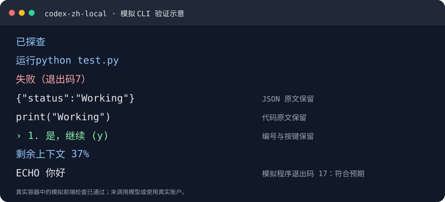
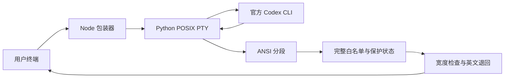

# stumbling-humanist
A humanities student's stumbling, groping way. No map, only footsteps; no guide, only trial, error, and looking back. Here live the books read, the detours taken, the abandoned attempts, and thoughts slowly brightening in the dark. May every stumble become a coordinate, every fumble leave its warmth — for those walking the same uncertain road.

---

# Codex CLI 中文提示包装器

**codex-zh-local** 将已确认的固定英文提示翻译为中文，帮助中文用户理解动作状态、错误、审批和快捷键。它通过独立入口启动官方 Codex CLI，基于 [taekchef/codex-code-zh-cn](https://github.com/taekchef/codex-code-zh-cn) 修订，保留 MIT 许可。

[报告问题与修复](ANALYSIS_RESPONSE.md) · [论文式技术报告](paper/PAPER.zh-CN.md) · [论文 PDF](paper/PAPER.zh-CN.pdf) · [当前验证材料](verification/1.2.1-local.2/README.md) · [全部译文](TRANSLATIONS.md) · [复现说明](CONTAINER_TEST.md)



图示根据已通过的模拟 CLI 检查绘制，是真实容器测试中样例行为的示意；不是模型任务截图。

## 项目摘要

| 项目 | 当前状态 |
|---|---|
| 版本 | 1.2.1-local.2 |
| 翻译范围 | 65 条记录、31 组确认提示；不是全部界面汉化 |
| 支持平台 | macOS / Linux；Node.js 18+、Python 3；测试脚本要求 Python 3.9+ |
| 运行依赖 | Node/Python 标准库；无 npm 依赖 |
| 文案开发基线 | 官方 Codex CLI 0.162.1 |
| 当前本机验证 | 69 项 Node、11 项 Python通过；8 份真实录制回放均出现中文 |
| 实际官方 CLI 启动 | 新包装器驱动官方 0.162.1，出现 82 个中文字符；临时配置、未提交模型任务 |
| 当前 Linux AMD64 容器/CI | 69 项 Node、6 项容器内 Python、5 项生命周期检查通过；完整模拟交互/安装卸载通过 |
| 历史 Linux ARM64 容器验证 | 旧版 local.1 的 58/6 通过记录另行保留 |
| 临时环境与宿主检查 | 临时 VM/Docker/镜像已清理；所列配置、认证哈希及官方入口未变 |
| 报告性质 | 工程技术报告；未经同行评审；未验证真实模型任务 |

## 为什么做这个修订

项目起于中文用户阅读 Codex CLI 英文提示的困难。修订目标是在保留官方程序和本机资料的前提下，翻译具体确认过的固定提示，并让改动能够检查和复现。实现修订、测试材料整理与报告撰写使用 Codex 辅助；需求选择与本机隔离测试由维护者完成，见 [来源与贡献](NOTICE.md)。

主要行为：

- **固定白名单**：只匹配完整提示，保留数量、退出码、百分比、错误详情、命令、路径和按键；保护明显代码与 JSON。
- **终端布局退回**：中文较宽时仅借用已有空格；空间不足或遇到光标控制时保留英文。25 ms 是刷新调度参数，不是性能测量结论。
- **非交互透传**：exec/review、协议服务、帮助/版本、重定向调用绕过翻译和额外 PTY。
- **独立入口**：安装生成 codex-zh-local，不接管官方 codex；卸载按所有权记录处理入口。
- **标准库 PTY**：保留中文输入、窗口尺寸、信号和退出状态，不编译或下载原生 npm 扩展。

## 架构



非交互调用直接透传。唯一生效词表是 [data/ui-translations-local.json](data/ui-translations-local.json)；旧词表仅留作历史参考。

## 使用

先安装并登录官方 Codex CLI，然后下载或克隆本仓库：

```sh
git clone https://github.com/hepenghd-lab/stumbling-humanist.git
cd stumbling-humanist
```

进入项目目录后：

```sh
node bin/codex-zh.js --codex-zh-help
node bin/codex-zh.js
```

如需独立命令入口：

```sh
bash install.sh
# 默认入口位于 ~/.local/bin；请确认该目录在 PATH 中。
codex-zh-local
```

若 Node 不在 PATH，设置 NODE_BIN 为已有可信 Node 可执行文件的完整路径。CODEX_ZH_BIN_DIR 可选择入口目录。源码目录需要保留在原位置；安装器不修改 shell 配置，也不下载依赖。

```sh
bash uninstall.sh
```

卸载保留源码和包装器自身设置。可用 --codex-bin 指定官方程序，--codex-zh-no-translate 透传，--codex-zh-lang zh|en 指定语言；/chinese 和 /english 只影响包装器语言设置。官方 Codex 的正常任务运行仍遵循其原有账户、权限和网络配置；本文的禁网限制针对测试容器。

## 验证与复现

当前修订针对真实 TUI 的无换行、SGR 拆分及光标定位，详见 [问题核实与修复](ANALYSIS_RESPONSE.md)。旧版容器材料仅证明旧版已测内容，不证明真实 TUI 可用或此次修订通过容器测试。当前修订材料位于 [verification/1.2.1-local.2](verification/1.2.1-local.2/README.md)。

```sh
# 离线重放全部脱敏真实录制
node scripts/replay_recordings.js verification/1.2.1-local.2/recordings
```

验证与容器复现：

```sh
# 核对旧版历史归档，输出其与当前源码的差异
python3 scripts/verify_public_evidence.py

# 已有可信 Docker 时，重新运行受限容器
python3 scripts/container_test.py

# macOS ARM64：临时 VM 测试并清理
bash run-container-test.command
```

历史及复现容器使用禁网、无宿主机挂载、非 root、只读根文件系统。公开材料包含当次源码归档、哈希、实际日志、隔离和清理结论；私密备份及真实账户材料没有上传。[验证记录](VALIDATION.md) 区分实际结果与未测试范围。

[GitHub Actions 当前修订复现已通过](https://github.com/hepenghd-lab/stumbling-humanist/actions/runs/38152691631)：Ubuntu runner 中实际执行受限 Docker 容器，Node 69 项、容器内 Python 6 项、另行生命周期 5 项全部通过。运行日志与结果已公开；此前 CI 的 macOS 路径假设已修正。

本机基础检查：

```sh
node --test
node scripts/validate-data.js
python3 -m unittest discover -s scripts -p 'test_*.py'
bash -n install.sh uninstall.sh scripts/container-entry.sh
```

## 译法依据和已知边界

译文参考牛津官方公开在线英文释义与 CLI 场景，自行拟定。没有取得《牛津高阶英汉双解词典》第10版完整英汉条目，不能声称与该版中文原文逐条一致。见 [译法记录](TRANSLATION_NOTES.md)。

终端流无法可靠标明 UI、正文和工具输出的来源。正文独立输出白名单提示时仍可能误译；代码保护是启发式。空间不足、字体宽度差异或新版界面更新可能导致保留英文或需要调整。当前验证包含真实官方启动及真实任务录制回放；没有重新执行真实模型任务、完整工具审批，也没有验证全部 Codex 版本或 Windows。

## 目录与引用

| 目录 / 文件 | 内容 |
|---|---|
| bin/、lib/、data/ | 包装器与词表 |
| scripts/、tests/ | 传输、安装和隔离测试工具 |
| verification/ | 脱敏后的实际验证证据 |
| paper/ | 中文论文式报告、PDF |
| CITATION.cff | 软件及报告引用信息 |
| LICENSE、NOTICE.md | MIT 许可、上游与贡献说明 |

报告以 GitHub 工程技术报告形式公开；未声称期刊录用、同行评审或 DOI。欢迎在 issue 中附版本、终端环境及可公开的最小复现。
